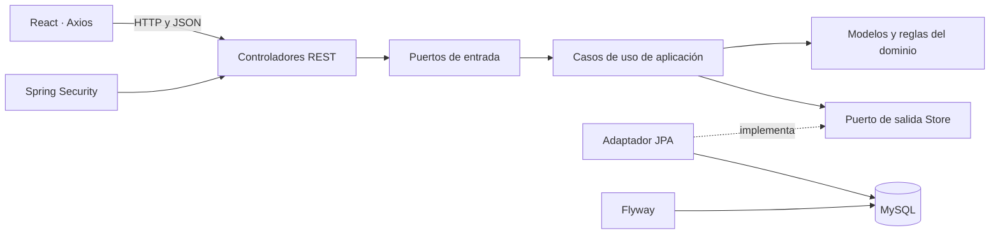
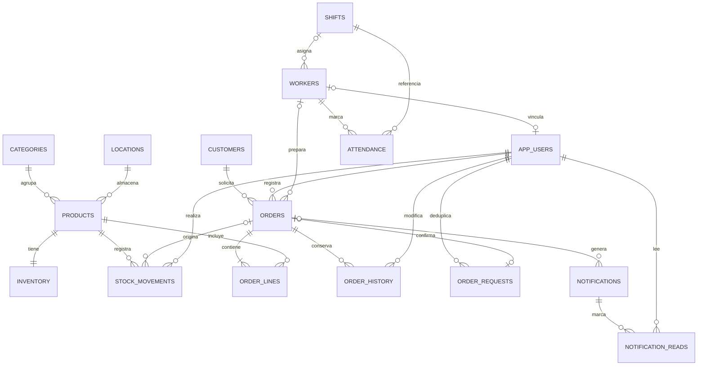

# Control360

Control360 es un sistema de gestión interna para una tienda con almacén propio. Es el proyecto final del curso **Desarrollo de Aplicaciones Web**.

Cuando los pedidos, el inventario y la asistencia se registran por separado, es fácil ofrecer unidades que ya están reservadas, duplicar la preparación de un pedido o confundir tiempo adicional con horas extra aprobadas. Control360 reúne esas operaciones y conserva el historial de los cambios.

## Objetivos

- Registrar pedidos y coordinar su preparación desde la solicitud hasta la entrega.
- Consultar existencias y ubicar productos por zona, pasillo y estante.
- Organizar a los trabajadores en turnos y registrar asistencias, tardanzas y tiempo extra.
- Dar al administrador una vista de la operación con métricas y alertas obtenidas de MySQL.

## Tecnologías

| Parte | Tecnologías |
| --- | --- |
| Backend | Java 17, Spring Boot, Spring Web, Bean Validation y Maven |
| Persistencia | MySQL 8.4, Spring Data JPA, Hibernate y Flyway |
| Seguridad | Spring Security, sesiones HTTP, CSRF y BCrypt |
| Frontend | React, Vite, JavaScript, Tailwind CSS, React Router, Axios, Lucide y Recharts |
| Pruebas | JUnit, Mockito, MockMvc y MySQL |

## Arquitectura hexagonal

El dominio define los modelos y las transiciones válidas de un pedido sin depender de Spring, HTTP o JPA. La aplicación expone puertos de entrada para pedidos y asistencia. Los casos de uso aplican las reglas de negocio mediante un puerto de salida que describe la persistencia y las transacciones. La infraestructura adapta HTTP, autentica con Spring Security y traduce los modelos a entidades JPA.



```text
Control360-DW/
├── backend/
│   ├── pom.xml
│   └── src/
│       ├── main/
│       │   ├── java/com/control360/
│       │   │   ├── domain/
│       │   │   ├── application/
│       │   │   └── infrastructure/
│       │   └── resources/db/migration/
│       └── test/
├── frontend/
│   ├── package.json
│   └── src/
│       ├── assets/       # Tema y estilos
│       ├── components/   # Tablas, formularios, diálogos y gráficos
│       ├── context/      # Sesión y preferencias
│       ├── hooks/        # Ciclo de carga y actualización de datos
│       ├── layouts/      # Navegación y barra superior
│       ├── pages/        # Módulos operativos
│       ├── routes/       # Rutas y protección por rol
│       └── services/     # Cliente Axios y formatos
├── docs/
├── compose.yaml
└── .env.example
```

## Base de datos

La cuenta tiene un rol `ADMIN`, `VENDEDOR` o `ALMACEN` que se valida en MySQL y Spring Security. Una cuenta de almacén se vincula a un trabajador. Un producto tiene una fila de inventario, una categoría y una ubicación. Los detalles del pedido guardan el precio aplicado al momento de la venta.



## Instalación y ejecución

Requisitos locales: **JDK 17**, **Maven 3.9+**, **Node.js 20.19+ o 22.12+** y **MySQL 8.4**. Docker Compose es opcional si ya tienes MySQL.

### MySQL y variables de entorno

1. Copia `.env.example` a `.env` si todavía no existe.
2. Revisa el host y puerto de tu servidor. MySQL usa `3306` de forma predeterminada. Si tu instancia escucha en `3307`, configura `MYSQL_PORT=3307`.
3. Configura `MYSQL_PASSWORD` y `ADMIN_PASSWORD` en `.env`. Para desarrollo puedes generar valores con `openssl rand -hex 24`. La contraseña del administrador requiere al menos 12 caracteres y un máximo de 72 bytes. Protege este archivo con `chmod 600 .env`.
4. Para usar Docker Compose, elige también un valor para `MYSQL_ROOT_PASSWORD` y ejecuta `docker compose up -d --wait`. Para usar un MySQL existente, crea el esquema exclusivo `control360_dw` y concede al usuario de la aplicación permisos sobre ese esquema para que Flyway pueda aplicar las migraciones.

El backend valida el esquema al arrancar con `ddl-auto=validate`. Flyway aplica las migraciones versionadas en `backend/src/main/resources/db/migration/`. La zona horaria de negocio se configura con `APP_ZONE`, cuyo valor inicial es `America/Lima`.

### Backend

Ejecuta desde la raíz del repositorio:

```bash
set -a
. ./.env
set +a
cd backend
mvn spring-boot:run
```

El backend escucha en el puerto `8080` de forma predeterminada. Al primer arranque, `ADMIN_USERNAME` y `ADMIN_PASSWORD` inicializan la cuenta administrativa si todavía no existe. Los cambios posteriores de contraseña se realizan desde la administración de usuarios.

### Frontend

En otra terminal, desde la raíz:

```bash
cd frontend
npm ci
npm run dev
```

Abre `http://localhost:5173` e inicia sesión con la cuenta inicial. Vite reenvía `/api` a `http://127.0.0.1:8080`. Si cambias `SERVER_PORT`, arranca Vite con el destino correspondiente, por ejemplo `API_TARGET=http://127.0.0.1:8081 npm run dev`. Para permitir un host de desarrollo adicional, configura `VITE_ALLOWED_HOSTS` con sus nombres separados por comas.

`npm run build` genera `frontend/dist/`. En un despliegue, sirve esos archivos y encamina `/api` al backend desde el mismo origen. Para HTTPS configura `COOKIE_SECURE=true`.

### Datos para la exposición

Para una base de demostración nueva, configura `DEMO_DATA=true` antes del primer arranque. Se crean categorías, ubicaciones, productos, clientes, trabajadores, asistencias y pedidos de ejemplo en MySQL. Para probar otros roles, asigna contraseñas locales a `DEMO_SELLER_PASSWORD` y `DEMO_WAREHOUSE_PASSWORD`. Los usuarios se llaman `demo_vendedor` y `demo_almacen`. Desactivar el modo de demostración evita nuevas cargas y conserva los registros existentes.

El [guion de la exposición](docs/demostracion.md) recorre el flujo de trabajo completo.

## Roles

| Rol | Funciones |
| --- | --- |
| Administrador | Gestiona usuarios, catálogo, existencias, ubicaciones, pedidos, trabajadores y turnos. Registra asistencia, aprueba minutos extra y consulta reportes. |
| Vendedor | Registra clientes y pedidos. Consulta existencias, sigue sus pedidos, cancela los pendientes y confirma entregas listas. |
| Trabajador de almacén | Consulta pedidos pendientes y asignados. Acepta y prepara pedidos durante su turno, consulta el plano y registra su asistencia. |

Los permisos se verifican en Spring Security y, para objetos como pedidos o asistencias individuales, en los casos de uso. El hash BCrypt se guarda en la base y nunca se devuelve en los DTO de usuario.

## API REST

| Método y ruta | Operación |
| --- | --- |
| `GET /api/auth/csrf` | Obtener token y nombre de la cabecera CSRF |
| `POST /api/auth/login` | Iniciar sesión |
| `GET /api/auth/me` · `POST /api/auth/logout` | Consultar o cerrar la sesión |
| `GET, POST /api/productos` · `PUT /api/productos/{id}` | Consultar, crear o actualizar productos |
| `GET /api/inventario/movimientos` · `POST /api/inventario/{id}/ajustes` | Consultar movimientos o ajustar existencias |
| `GET, POST /api/categorias` · `PUT /api/categorias/{id}` | Consultar y administrar categorías |
| `GET, POST /api/ubicaciones` · `PUT /api/ubicaciones/{id}` | Consultar y administrar ubicaciones |
| `GET, POST /api/clientes` | Consultar y registrar clientes |
| `GET, POST /api/pedidos` · `GET /api/pedidos/{id}` | Listar, registrar o consultar el detalle de un pedido |
| `POST /api/pedidos/{id}/aceptar` · `PUT /api/pedidos/{id}/estado` | Aceptar un pedido o cambiar su estado |
| `GET, POST /api/trabajadores` · `PUT /api/trabajadores/{id}` | Consultar disponibilidad y administrar trabajadores |
| `GET, POST /api/turnos` · `PUT /api/turnos/{id}` | Consultar y administrar turnos |
| `GET, POST /api/usuarios` · `PUT /api/usuarios/{id}` | Administrar cuentas y roles |
| `GET /api/asistencias` · `GET /api/asistencias/faltas` | Consultar historial y faltas por rango |
| `POST /api/asistencias/entradas` · `POST /api/asistencias/salidas` | Marcar entrada o salida |
| `PUT /api/asistencias/{id}/aprobar` | Aprobar hasta los minutos adicionales registrados |
| `GET /api/calendario` · `GET /api/dashboard` · `GET /api/reportes/resumen` | Consultar fecha de negocio, panel y reportes |
| `GET /api/notificaciones` · `POST /api/notificaciones/leer` | Consultar y marcar avisos como leídos |

Los filtros de fechas usan `from` y `to` en formato `AAAA-MM-DD`. Para mutaciones, conserva la cookie de sesión y envía la cabecera devuelta por `GET /api/auth/csrf`. Obtén un nuevo token después de iniciar sesión. Al registrar pedidos, puedes enviar `Idempotency-Key` para reutilizar el pedido anterior si repites el mismo contenido. La interfaz envía esa clave automáticamente.

La API responde con `200` para consultas y actualizaciones, `201` para creaciones, `204` para operaciones sin respuesta, `400` para validación, `401` para falta de autenticación, `403` para acceso denegado, `404` para recursos inexistentes, `409` para conflictos y `500` para errores inesperados.

## Pruebas

Desde `backend/`, ejecuta `mvn test` para los casos de uso unitarios. Para integración, configura un esquema separado con sufijo `_test`. Por ejemplo, conectado a MySQL como administrador y con un usuario de aplicación creado:

```sql
CREATE DATABASE control360_dw_test CHARACTER SET utf8mb4;
GRANT ALL ON control360_dw_test.* TO 'control360'@'%';
```

Carga las variables de conexión y ejecuta `CONTROL360_TEST_DATABASE=control360_dw_test mvn verify -Pmysql-it`. Las pruebas aplican Flyway al esquema de pruebas y crean registros con identificadores únicos. Cubren autenticación, CSRF, permisos, productos, reservas, devolución, aceptación concurrente, preparación, entrega, asistencia y reportes. Desde `frontend/`, ejecuta `npm ci && npm run build` para verificar la compilación de React.

## Limitaciones conocidas

- Los turnos e inventario mostrados en reportes corresponden a la configuración vigente. Las marcaciones conservan la hora de salida programada de su jornada. Las faltas anteriores a la fecha de alta de un trabajador quedan excluidas. Las reasignaciones de turno no guardan versiones históricas.
- Las listas y reportes están preparados para un volumen académico. La aplicación usa una instancia de backend con sesiones HTTP locales.
- Los avisos internos se actualizan cada 20 segundos en el navegador. La aplicación cubre operaciones internas y no incluye comercio público ni pagos.
